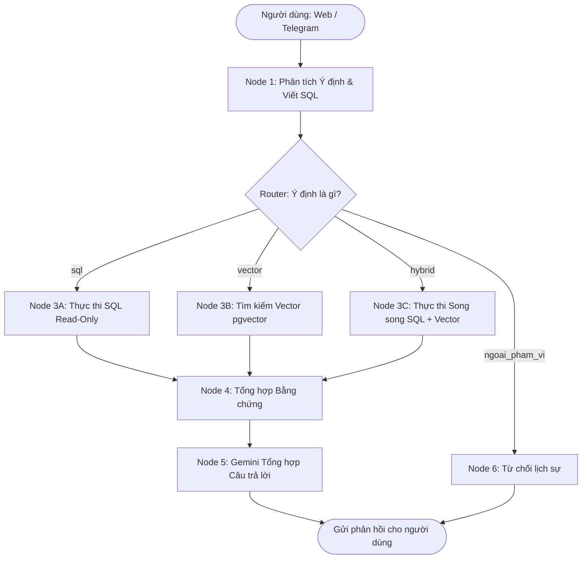

# 🎓 TRỢ LÝ RAG & TEXT-TO-SQL TRA CỨU PHIẾU BÁO THI VÀO LỚP 10 (LỚP 9A5)

Hệ thống AI Agent thông minh hỗ trợ tra cứu phiếu báo thi tuyển sinh vào lớp 10 THPT năm học 2026-2027 cho 43 học sinh lớp 9A5, trường THCS Chu Văn An, Hà Nội. 

Dự án kết hợp kiến trúc **Hybrid RAG**:
- **Dynamic Text-to-SQL (Read-only)**: Tự động phân tích schema CSDL PostgreSQL và sinh câu lệnh SQL an toàn để tra cứu thông tin cá nhân, số báo danh, phòng thi, nguyện vọng, và các câu hỏi thống kê / tổng hợp phức tạp.
- **Vector Retrieval (pgvector + Gemini Embedding)**: Tra cứu ngữ nghĩa về các quy chế thi, lịch thi chung, hướng dẫn làm thủ tục dự thi.
- **Đa kênh tương tác**: Hỗ trợ giao diện Web Chatbot hiện đại (FastAPI + Tailwind CSS) và tích hợp **Telegram Bot** hoạt động 24/7.

---

## 📌 Tính Năng Nổi Bật

1. **Dynamic Schema Introspection & Text-to-SQL Tự Động**:
   - Hệ thống tự động quét metadata `information_schema` và chú thích `COMMENT` của các bảng trong CSDL.
   - LLM tự động sinh truy vấn `SELECT` chính xác theo câu hỏi tự nhiên mà không cần viết trước các hàm cố định.
   - Cơ chế tự sửa lỗi truy vấn (Self-Correction 1 bước) khi gặp lỗi cú pháp PostgreSQL.
2. **Cơ Chế Phòng Thủ Chiều Sâu (Defense in Depth)**:
   - **Tầng Ứng Dụng**: Kiểm tra Regex nghiêm ngặt (chỉ cho phép `SELECT`, cấm tuyệt đối `;`, `DROP`, `UPDATE`, `DELETE`, `INSERT`...).
   - **Tầng Database**: Thực thi trong phiên giao dịch `READ ONLY` độc lập (`conn.set_session(readonly=True)`).
3. **Định Tuyến Ý Định Thông Minh (LangGraph StateGraph)**:
   - Phân loại 4 nhóm ý định: `sql` (thông tin cá nhân/thống kê), `vector` (quy chế chung), `hybrid` (kết hợp cả hai), và `ngoai_pham_vi` (từ chối an toàn).
   - Xử lý đồng thời (song song) SQL và Vector Search bằng `ThreadPoolExecutor` cho câu hỏi Hybrid.
4. **Tối Ưu Tốc Độ Phản Hồi (High Performance)**:
   - Hợp nhất bước phân tích ý định và sinh SQL làm 1 lượt gọi LLM duy nhất.
   - Sử dụng mô hình `gemini-3.1-flash-lite` với thời gian phản hồi ~1.1s.
   - Kết nối CSDL dạng Pool (`ThreadedConnectionPool`) và bộ nhớ đệm RAM (`LRU Cache`) cho Embedding và câu trả lời lặp lại.
   - Cơ chế khởi động làm ấm (Warm-up) ngầm loại bỏ độ trễ Cold-Start.
5. **Giao Diện Đa Nền Tảng**:
   - Web Chat UI trực quan, phong cách ChatGPT, hỗ trợ Markdown.
   - Bot Telegram (`@bao_thi_bot`) với cơ chế tự động thử lại ở tầng mạng chống rớt kết nối.

---

## 🏗️ Kiến Trúc Hệ Thống



---

## 📂 Cấu Trúc Thư Mục

```text
rag dữ liệu 9a5/
├── ung_dung/                      # Mã nguồn chính của ứng dụng
│   ├── api.py                     # API FastAPI + Web Chat UI
│   ├── bot_telegram.py            # Bot Telegram kết nối người dùng
│   ├── cau_hinh.py                # Quản lý biến môi trường và cấu hình
│   ├── chatbot/                   # Lõi AI Agent (LangGraph)
│   │   ├── cac_node.py            # Định nghĩa các bước xử lý (Node 1 -> Node 6)
│   │   ├── cac_prompt.py          # Prompt hệ thống cho Gemini
│   │   ├── do_thi.py              # Đồ thị StateGraph & hàm hỏi công khai
│   │   └── trang_thai.py          # Kiểu dữ liệu trạng thái hội thoại
│   ├── co_so_du_lieu/             # Thao tác PostgreSQL
│   │   ├── quet_schema.py         # Quét cấu trúc bảng và khóa ngoại động
│   │   └── truy_van.py            # Connection Pool & kiểm tra an toàn SQL
│   └── tim_kiem/                  # Tìm kiếm ngữ nghĩa
│       └── tim_kiem_vector.py     # Gemini Embedding + pgvector Cosine Distance
├── du_lieu/                       # Dữ liệu tài liệu & phiếu báo thi
│   └── tai_lieu_chung/            # Văn bản quy chế, lịch thi chung
├── kiem_thu/                      # Các kịch bản kiểm thử tự động
│   └── thu_kich_ban_chat.py       # Kiểm thử 8 nhóm use case thực tế
├── dulieu_backup.sql              # Bản dump CSDL hoàn chỉnh (43 thí sinh + vector)
├── requirements.txt               # Danh sách thư viện phụ thuộc
├── render.yaml                    # Cấu hình triển khai tự động lên Render.com
└── README.md                      # Tài liệu hướng dẫn dự án
```

---

## 🚀 Hướng Dẫn Cài Đặt & Chạy Cục Bộ (Local)

### 1. Yêu Cầu Tiên Quyết
- **Python**: Phiên bản 3.11 hoặc 3.12.
- **Docker Desktop**: Dùng để chạy PostgreSQL có cài extension `pgvector`.
- **Google Gemini API Key**: Lấy từ Google AI Studio.
- **Telegram Bot Token**: Lấy từ `@BotFather` trên Telegram.

### 2. Khởi Động PostgreSQL với Docker
Khởi chạy container PostgreSQL có hỗ trợ `pgvector`:
```powershell
docker run -d `
  --name postgres-rag `
  -e POSTGRES_DB=rag_thi_tuyen_sinh `
  -e POSTGRES_USER=postgres `
  -e POSTGRES_PASSWORD=123456 `
  -p 5433:5432 `
  --restart unless-stopped `
  pgvector/pgvector:pg16
```

Khôi phục dữ liệu từ file backup vào container:
```powershell
docker exec -i postgres-rag psql -U postgres -d rag_thi_tuyen_sinh < dulieu_backup.sql
```

### 3. Cài Đặt Môi Trường Python
```powershell
# Tạo môi trường ảo
python -m venv venv

# Kích hoạt môi trường (Windows PowerShell)
.\venv\Scripts\Activate.ps1

# Cài đặt các thư viện cần thiết
pip install -r requirements.txt
```

### 4. Cấu Hình Biến Môi Trường
Tạo file `.env` tại thư mục gốc với nội dung:
```env
# Gemini API
GEMINI_API_KEY=your_gemini_api_key_here
GEMINI_CHAT_MODEL=gemini-3.1-flash-lite

# PostgreSQL Database (kết nối tới Docker port 5433)
POSTGRES_HOST=localhost
POSTGRES_PORT=5433
POSTGRES_USER=postgres
POSTGRES_PASSWORD=123456
POSTGRES_DB=rag_thi_tuyen_sinh

# Telegram Bot
TELEGRAM_BOT_TOKEN=your_telegram_bot_token_here
```

### 5. Khởi Chạy Ứng Dụng

- **Chạy Giao Diện Web (FastAPI):**
  ```powershell
  python -m ung_dung.api
  ```
  👉 Truy cập trình duyệt tại: `http://localhost:8000`

- **Chạy Bot Telegram:**
  ```powershell
  python -m ung_dung.bot_telegram
  ```
  👉 Vào Telegram và trò chuyện trực tiếp với bot của bạn.

---

## 🌐 Hướng Dẫn Triển Khai Lên Render.com (24/7 Miễn Phí)

Dự án đã tích hợp sẵn file cấu hình **`render.yaml`** (Infrastructure as Code) giúp triển khai tự động chỉ với vài bước:

1. Đẩy mã nguồn dự án lên một kho lưu trữ **GitHub**.
2. Đăng nhập vào [Render.com](https://dashboard.render.com/) bằng tài khoản GitHub.
3. Chọn **New +** ➔ **Blueprint**.
4. Chọn repository GitHub vừa tạo. Render sẽ tự động:
   - Tạo cơ sở dữ liệu **PostgreSQL** (Khu vực Singapore, hỗ trợ pgvector).
   - Tạo **Web Service** chạy Python kết hợp cả Web UI và Bot Telegram.
5. Nhập các giá trị bí mật khi Render yêu cầu:
   - `GEMINI_API_KEY`: Key Gemini của bạn.
   - `TELEGRAM_BOT_TOKEN`: Token Telegram của bạn.
6. Sau khi Database được tạo, kết nối vào DB trên Render và import file `dulieu_backup.sql`:
   ```bash
   psql "<EXTERNAL_DATABASE_URL_RENDER>" -f dulieu_backup.sql
   ```
7. *(Tùy chọn)* Cài đặt ping định kỳ 10 phút/lần tại [cron-job.org](https://cron-job.org) trỏ về URL Render của bạn để chống rơi vào chế độ ngủ đông (Sleep).

---

## 🧪 Các Nhóm Use Case Thử Nghiệm Chuẩn

Hệ thống đã được kiểm thử toàn diện qua 8 nhóm kịch bản:
1. **Truy vấn cá nhân**: *"Số báo danh của Đặng Linh An là bao nhiêu?"* ➔ Trả lời chính xác SBD 204001.
2. **Thống kê & Đếm**: *"Lớp có bao nhiêu bạn nữ?"* / *"Tổng các bạn thi tại THPT Nguyễn Quốc Trinh?"* ➔ Đếm chính xác qua SQL `COUNT(*)`.
3. **Lịch thi & Địa điểm**: *"Bạn Bảo Anh thi ở trường nào và mấy giờ phải có mặt làm thủ tục?"* ➔ Phản hồi chính xác địa chỉ và khung giờ.
4. **Hỏi tiếp nối ngữ cảnh**: *"Bạn đó có những nguyện vọng nào?"* ➔ Nhận diện đúng thí sinh ở lượt hội thoại trước.
5. **Quy chế chung (Vector)**: *"Buổi sáng mấy giờ phải có mặt tại phòng thi?"* ➔ Trích xuất đúng 7h00 từ quy chế.
6. **Truy vấn hỗn hợp (Hybrid)**: Vừa hỏi phòng thi cá nhân, vừa hỏi giờ tập trung chung.
7. **Tìm kiếm không dấu**: *"so bao danh cua hoang bao anh"* ➔ Extension `unaccent` xử lý chuẩn xác.
8. **Phòng vệ ngoài phạm vi & Injection**: *"Hôm nay thời tiết thế nào?"* / *"DROP TABLE thi_sinh"* ➔ Hệ thống từ chối an toàn.

---

## 📄 Bản Quyền & Giấy Phép
Dự án được xây dựng phục vụ nghiên cứu và thực tập trong chương trình AI Agent tra cứu dữ liệu giáo dục.
